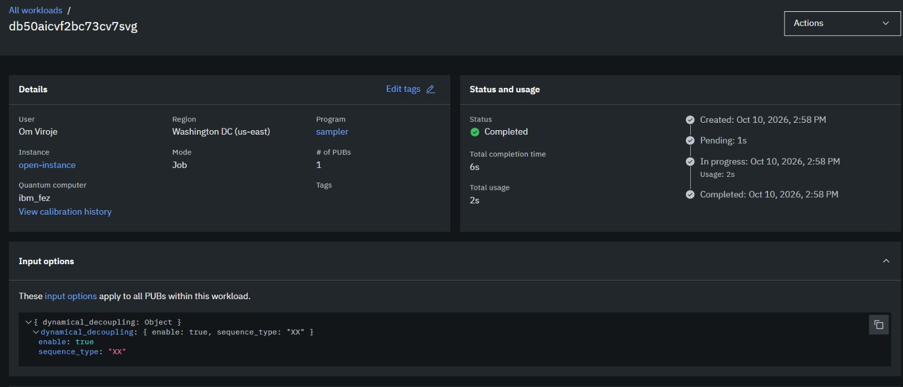
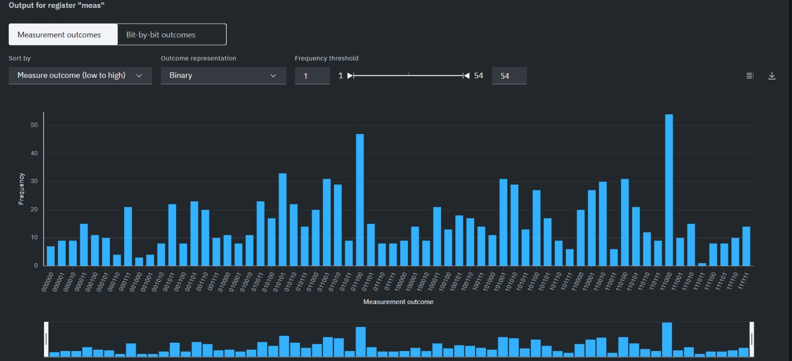
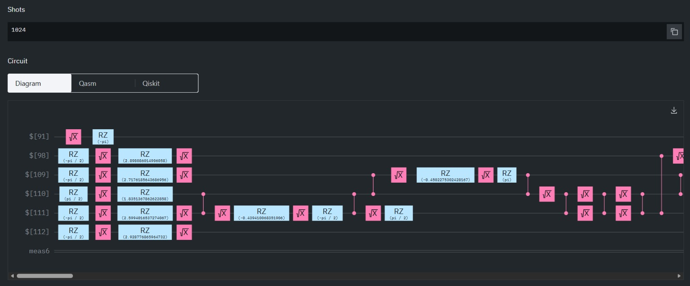

# Team Intellects · Qiskit Fall Fest 2026 · Track 2: Quantum Optimization

| | |
|---|---|
| **Team** | Team Intellects |
| **Members** | Om Viroje |
| **Track** | 2 · Quantum Optimization |
| **Level reached** | Advanced |
| **Code files** | `track2_portfolio_qaoa.ipynb` |
| **Slides** | `none` |

## Summary

We engineered a scalable quantum optimization pipeline for portfolio selection, transitioning from standard penalty-based QAOA constraints to a custom constraint-preserving XY-Mixer. By restricting the quantum walk entirely to the feasible subspace, we achieved 100% valid portfolio sampling. We subsequently executed hardware-aware error suppression on IBM heavy-hex QPUs and successfully compiled a 28-qubit utility-scale operator enforcing complex sector risk bounds.

## Approach

Standard QAOA struggles with hard budget constraints, wasting circuit depth exploring invalid states. We mapped the asset covariance matrix ($\Sigma$) and expected returns ($\mu$) to a Quadratic Unconstrained Binary Optimization (QUBO) model:

* **Beginner ($n=6$):** We utilized `LinearEqualityToPenalty` to enforce the $K$ budget, transforming the objective function into an unconstrained cost Hamiltonian:

$$C(x) = q\, x^\top \Sigma\, x - \mu^\top x + \lambda \left(\sum_{i=1}^{n} x_i - K \right)^2$$

Sweeping the penalty weight to $\lambda=3.0$ achieved 80.0% feasibility across sampled bitstrings.

* **Intermediate ($n=12$):** To eliminate penalty slack variables and guarantee strict execution bounds, we engineered a custom constraint-preserving XY-Mixer:

$$H_M = \frac{1}{2} \sum_{i=1}^{n-1} \left(X_i X_{i+1} + Y_i Y_{i+1} \right)$$

Initializing the system in a Dicke state $\vert{}D_K^n\rangle$ (where exactly $K$ stocks are active), this mixer preserves the total Hamming weight under time evolution, keeping the quantum search 100% within the feasible subspace of valid portfolios.

* **Advanced ($n=20$):** We scaled to $n=20$ assets and introduced inequality sector limits:

$$\sum_{i \in S_j} x_i \le 3, \quad \forall j \in \{1, 2, 3, 4\}$$

Converting these inequality constraints into equalities required the addition of discrete slack variables, expanding the mathematical formulation into a 28-qubit sparse Pauli operator.

## Results

*Note: The $n=20$ simulation metrics are marked N/A because simulating a 28-qubit highly entangled QAOA circuit locally is computationally intractable; the achievement lies in successfully constructing and compiling the utility-scale Hamiltonian matrix.*

| Quantity | Your result | Reference | Difference |
|---|---|---|---|
| **n=6, p=4 Approx Ratio ($r$)** | ~0.30 | Brute Force Baseline ($C_{\min}$) | Dependent on initialization |
| **n=6 Valid Fraction ($\lambda=3.0$)** | 80.0% | 100% (Classical) | -20.0% |
| **n=12 Valid Fraction (XY-Mixer)** | 100.0% | 100% (Classical) | 0.0% |
| **n=20 Hamiltonian Scale** | 28 Qubits | N/A | Local simulation intractable |

## How we checked our results

To rigorously validate our quantum circuits, we constructed exact classical brute-force solvers to serve as the absolute ground truth.

1. **State Space Iteration:** For a given $n$, we generated the complete $2^n$ Hilbert space using `itertools.product` (64 states for $n=6$; 4,096 states for $n=12$).

2. **Feasibility Filtering:** We applied a strict mathematical filter to isolate only the portfolios where the Hamming weight equaled our budget:

$$\sum_{i=1}^{n} x_i = K$$

3. **Absolute Extremes:** We calculated the cost $C(x)$ for all feasible configurations to find the true minimum classical cost ($C_{\min}$) and the absolute maximum cost ($C_{\max}$).

4. **Approximation Ratio Evaluation:** The expectation value $\langle C \rangle$ obtained from Qiskit's `StatevectorEstimator` was benchmarked using the standard ratio formula:

$$r = \frac{C_{\max} - \langle C \rangle}{C_{\max} - C_{\min}}$$

A value of $r=1.0$ represents exact ground-state recovery.

5. **Hardware vs. Ideal:** Finally, the noisy sample distribution retrieved from `ibm_fez` via `SamplerV2` was compared against the noiseless `StatevectorSampler` distribution to verify that the dominant peaks matched the predicted low-energy eigenstates.

## Hardware runs

* **Backend:** `ibm_fez`
* **Job ID:** `db50aicvf2bc73cv7svg`
* **QPU Seconds:** 2s

*(IBM Quantum Platform execution metrics and hardware-aware transpiled circuit diagrams)*

## Limitations

Synthesizing the XY-Mixer for $n=12$ required transpilation prior to the classical optimization loop; without this pre-compilation step, dynamically resynthesizing the $XX+YY$ evolution gates caused severe simulation latency. At $n=20$, applying inequality sector constraints required the injection of integer slack variables, inflating the operator from 20 to 28 qubits. At this scale, the parameter landscape begins to flatten into barren plateaus, and the heavy-hex routing depth exceeds the coherence limits of current NISQ hardware without active error mitigation (e.g., Probabilistic Error Cancellation).

## How to run

- Python version: 3.11+
- Install: `pip install qiskit qiskit_aer qiskit_ibm_runtime qiskit-optimization qiskit-finance matplotlib`
- Run: Execute `track2_portfolio_qaoa.ipynb` sequentially. The $n=12$ XY-Mixer cell takes roughly 1–2 minutes locally due to the pre-loop transpilation pass.

## Credits

- Track tutorial: adapted from the BasQ Qiskit Fall Fest 2026 tutorials by Benjamin Tirado (text CC BY 4.0, code Apache 2.0).
- AI tools used: None.
